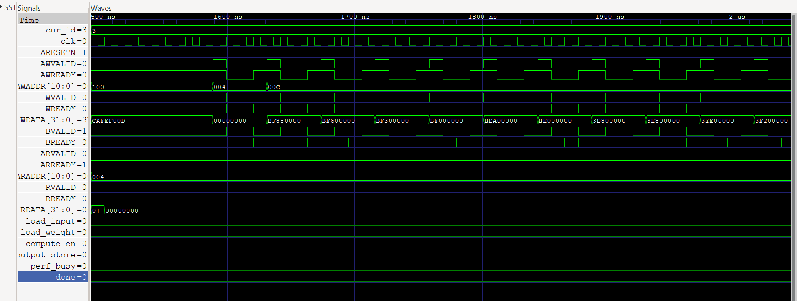
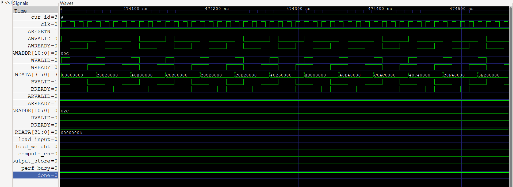
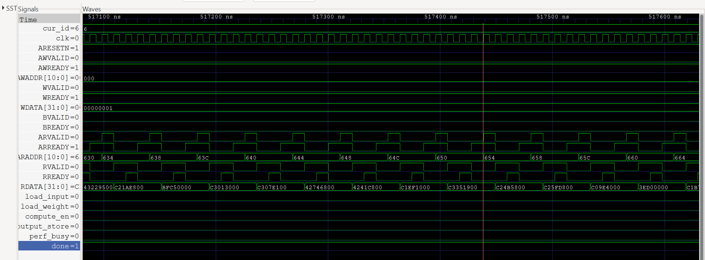
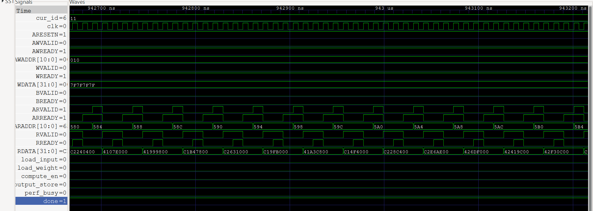

# FP32 MNIST CNN Accelerator on PYNQ-Z2 (4x4 systolic array)

[](https://github.com/VarunKB06/FP32_MNIST_CNN_Accelerator/actions/workflows/ci.yml)

-brightgreen)
-brightgreen)

FP32 MNIST convolutional neural network accelerated on a **PYNQ-Z2 (Zynq-7020)** with a **4x4 systolic array (16 processing
elements)**. Larger matrix products are tiled onto the physical 4x4 array. The array is controlled from the ARM processor over
AXI4-Lite; Python does the preprocessing and orchestration. Academic major project.

> The CI badge shows the status of the Python checks and the RTL simulation (GitHub Actions). The other three badges are static
> and describe the recorded board and Vivado results below.

## Results at a glance
| | |
|---|---|
| Board validation (200 MNIST images) | 197/200 correct (98.50%), 200/200 predictions equal PyTorch, max logit difference 1.14e-05 |
| Hardware cost | 77,730 cycles/image = 825.9 us at 94.1 MHz (hardware only, about 1,211 images/s) |
| End-to-end on the ARM PS | 57.15 ms/image, 17.5 images/s (Python preprocessing and AXI transfers dominate) |
| FPGA resources | 10,366 LUTs (19.5%), 8,184 FFs (7.7%), 32 DSPs (14.6%), 0 BRAM |
| Timing | clock 94.1176 MHz, setup WNS +0.179 ns, hold WHS +0.024 ns, 0 failing endpoints |
| Power | Vivado estimate 1.735 W total (PS7 1.526 W); an estimate, not a measurement |
| RTL verification | self-checking AXI4-Lite testbench: 17/17 tests pass for seeds 1, 2, 3 (Icarus Verilog, GitHub Actions); 26/26 event and 30/30 cross coverage bins |

Details, methodology and caveats: [docs/FPGA_RESULTS.md](docs/FPGA_RESULTS.md). The 58.8 MHz clock printed by the first CNN
board runs was a PYNQ clock-API value; the implemented design runs at 94.1176 MHz and the time-based figures were recomputed
(cycle counts and all measured quantities are unchanged).

## Network
MNIST 28x28 -> Conv 3x3, 8 filters (stride 1, valid) -> ReLU -> 2x2 max-pool -> flatten (1,352) -> fully connected (10).
Convolution patches (9 pixels + bias slot) and 16-feature blocks of the FC layer are mapped onto the accelerator.

## Architecture
`design.v` (FP32 multiplier/adder pipelines, PE, 4x4 array, controller FSM, address generator, buffers, performance monitor,
`cnn_accelerator_top`) and `axi.v` (AXI4-Lite wrapper). Register map: CTRL 0x000 (bit0 start, bit1 soft reset), SIZE 0x004,
STATUS 0x008 (done, busy, input_loaded, weight_loaded, output_valid), FEATURE 0x00C, WEIGHT 0x010, performance counters
0x014-0x02C, hardware ID 0x030 (0x4D4D3031), output window 0x400-0x7FC. See [docs/ARCHITECTURE.md](docs/ARCHITECTURE.md).

## Verification
| Item | Status |
|---|---|
| RTL testbench `tb/tb_cnn_accelerator_axi.v` | self-checking; AXI4-Lite master model, scoreboard, procedural protocol checkers, coverage; **17/17 tests pass, seeds 1, 2, 3 (GitHub Actions)** |
| Software model self-tests (`cnn_reference.py --selftest`, `--n 200`) | CI job `python-reference` |
| PYNQ-Z2 runs (10 and 200 images; matrix test 4x4/8x8/16x16) | done, results recorded |
| AXI protocol compliance by formal methods | not done (procedural checks only) |
| Full Vivado rebuild from source | not available (project and constraints not in this repo) |
| Measured board power | not available (estimates only) |
| Full 10,000-image MNIST test set on the board | not done |

### RTL testbench (`tb/tb_cnn_accelerator_axi.v`)
- **AXI4-Lite master model:** AW/W simultaneously, AW first or W first, random gaps, BREADY/RREADY back-pressure.
- **Scoreboard:** independent integer model of Y = X.W. Operands are multiples of 1/16, so every FP32 result is exact and is
  compared bit-for-bit; plus **golden vectors** (`vectors/golden_16x16.hex`) from the bit-accurate software model for general
  FP32 data, including real convolution and FC blocks of the network (regenerate with `python3 tools/gen_golden_vectors.py`).
- **Checkers (procedural, not native SVA):** BRESP/RRESP OKAY, response/data held until ready, no response without AW and W, no
  read data without AR, no ready while a response is pending, no X on outputs, responses idle during reset, one FSM phase active at
  a time, output store only during compute.
- **Tests:** reset values and ID; register read/write and read-only/unmapped writes; 4x4 identity (the original basic test); 4x4
  directed; 3 sizes x 7 data classes; performance counters equal to the board measurements; back-to-back mixed-size runs; weight
  reuse; re-run without reload; START before data; writes ignored while busy; soft reset and AXI reset during a run; AW/W order and
  delay variations; back-pressure; golden vectors; seeded constrained-random stress.
- **Coverage:** hand-written event and cross bins (sizes, data classes, write orders, back-pressure, resets, reuse, ...); not
  RTL code coverage.

## RTL simulation results (GitHub Actions, Icarus Verilog, `tb_cnn_accelerator_axi`)
| Item | seed 1 | seed 2 | seed 3 |
|---|---|---|---|
| Tests passed / failed | 17 / 0 | 17 / 0 | 17 / 0 |
| Testbench / scoreboard errors | 0 | 0 | 0 |
| Protocol checker failures | 0 | 0 | 0 |
| Total checks | 12,189 | 12,093 | 13,149 |
| Checker evaluations | 256,222 | 248,618 | 271,348 |
| Functional EVENT bins | 26 / 26 | 26 / 26 | 26 / 26 |
| Functional CROSS bins | 30 / 30 | 30 / 30 | 30 / 30 |
| Final | PASS | PASS | PASS |

Logs: `reports/ci_logs/`; seed-1 extracts in `reports/rtl_simulation_summary.txt`, `reports/rtl_coverage_summary.txt` and
`reports/rtl_protocol_checker_summary.txt`. What the passing results show:
- **T06:** the simulated performance counters equal the cycle counts measured on the board (64 / 287 / 1,627 total cycles for 4x4 / 8x8 / 16x16), so the RTL in this repository matches the bitstream on that metric.
- **T05, T07-T09, T17:** exact-data runs (3 sizes x 7 data classes, back-to-back, weight reuse, re-run, random) match the integer reference bit-for-bit.
- **T16:** 8 general FP32 16x16 vector sets, including real convolution and fully-connected blocks, match the bit-accurate software model bit-for-bit.
- **T10-T13:** START before data, writes ignored while busy, and soft / AXI reset during a run behave as specified and the accelerator recovers.
- Icarus prints a harmless "no explicit time unit" warning for the RTL files (they contain no delays).
Coverage is hand-written functional coverage, not RTL code coverage; the checkers are procedural, not native SVA. This is RTL simulation, not formal proof.

## Waveforms (GTKWave, from the CI simulation)
Captured from the VCD uploaded by the CI `waveform` job (tests 3, 6, 11, 12 and 14 are dumped; `cur_id` is the active test, and the `x` gaps between tests are simply the dump being switched off). All channels are AXI4-Lite; the clock is about 94.1 MHz.


*T3 (4x4 identity): a SIZE write (AWADDR 0x004, data 0 = 4x4) followed by FEATURE writes (AWADDR 0x00C), for example BF880000 = -1.0625 and BF600000 = -0.875. Each write completes with the AW/W handshake and then B.*


*T6 (performance-counter test, 16x16): back-to-back FEATURE writes with AW/W/B handshakes. ARADDR/RDATA still show the last counter read: address 0x02C (idle-cycle counter) = 0x0000000D = 13 cycles for the preceding 8x8 run, matching the board measurement.*


*T6: after `done` goes high, the result matrix is read back through the output window (ARADDR 0x630, 0x634, ...; RDATA carries the FP32 results) with AR/R handshakes.*


*T11: data writes made while a run was active (the last one, 0x7F7F7F7F to the weight register 0x010, is still on the bus) were ignored; after `done` the results are read back and match the reference.*

## Run
```bash
# software model (NumPy only)
python cnn_reference.py --selftest
python cnn_reference.py --n 200

# RTL simulation (Icarus Verilog 12 or newer)
mkdir -p build waveforms
iverilog -g2012 -s tb_cnn_accelerator_axi -o build/sim.vvp design.v axi.v tb/tb_cnn_accelerator_axi.v
vvp build/sim.vvp +seed=1            # add +vcd to write waveforms/tb_cnn_accelerator_axi.vcd (GTKWave)

# on the PYNQ-Z2 board (design_1.bit / design_1.hwh in the same folder)
python3 test.py                      # interactive matrix-level test
python3 cnn_pynq.py --n 200          # CNN evaluation on the board
```
The simulation prints `FINAL: PASS` or `FINAL: FAIL` and the coverage summary. The older `tb/tb_identity_basic.v` is the original
print-only 4x4 identity test and is not used in CI.

## CI (GitHub Actions)
`.github/workflows/ci.yml`: job `python-reference` (compile, self-tests, 200-image software-twin evaluation), job
`rtl-simulation` (seeds 1, 2, 3; fails on compile error, non-zero status, failed test, checker failure or missing seed), job
`waveform` (uploads a VCD artifact). Trigger: every push / pull request, or *Actions -> CI -> Run workflow*.

## Repository contents
```
design.v, axi.v                 accelerator RTL and AXI4-Lite wrapper
design_1.bit, design_1.hwh      PYNQ bitstream and hardware handoff
tb/                             tb_cnn_accelerator_axi.v (self-checking), tb_identity_basic.v (original)
vectors/golden_16x16.hex        golden vectors for the testbench;  tools/gen_golden_vectors.py regenerates them
accel_driver.py, cnn_pynq.py    PYNQ driver and CNN flow;  test.py  matrix-level board test
cnn_reference.py                NumPy reference and bit-accurate software twin;  train_mnist.py  training/export
model/                          mnist_cnn.npz, mnist_test_subset.npz
reports/                        hardware_validation_200.csv, matrix_test_console_excerpt.txt, vivado/ (utilization, timing, summary)
docs/                           ARCHITECTURE.md, FPGA_RESULTS.md, TEST_IMAGE_RESULTS.md, images/ (Vivado power summary)
test_images/                    montage of test images
```

## Known limitations
- Physical 4x4 array only; the 16x16 operations are tiled. It is not a 16x16 PE array.
- The original Vivado project and XDC constraints are not in this repository; the bitstream and handoff are provided.
- Results use a 200-image subset; power and energy are estimates; the timing report values were decoded from a binary report.
- Software side dominates end-to-end time; bulk/DMA transfers, data reuse and hardware preprocessing are future work (not implemented).
- No license file is included yet.
